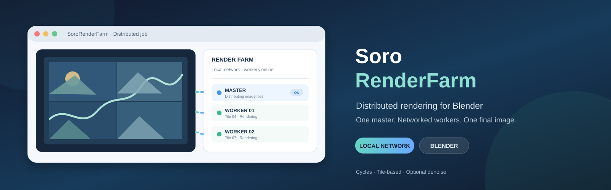

# SoroRenderFarm — README banner

Distributed rendering over a local network for Blender — one master workstation distributes image tiles to networked worker computers, which render and return the tiles for final image assembly.

## Project links
- [Português documentation](README.md)
- [English documentation](README.en.md)
- [Download the add-on](soro_renderfarm.py)
- [Releases](https://github.com/ricardorocadas2026/SoroRenderFarm/releases)

> Banner artwork is available as [`banner.svg`](banner.svg). To display it at the top of either project README, add `` below the language selector.
