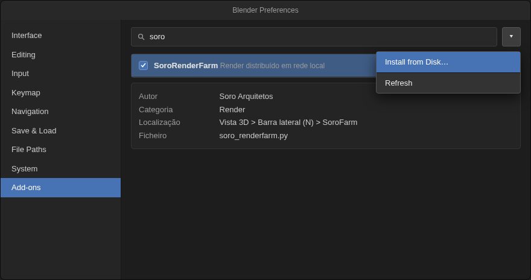
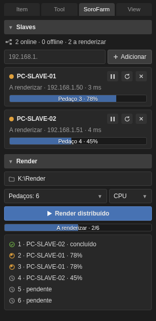

# SoroRenderFarm

Languages: [Português](README.md) · English

Distributed rendering over a local network for Blender — a single Python file. No Internet, no accounts, no keys.

The add-on splits an image render into tiles, spreads them across computers on the same local network and stitches everything back into a final image, with an optional Denoise step. It works with one main machine (Master) and several slaves.

**Version 0.5.0** · Blender 3.6 or newer · Designed for Windows

---

## How it works

- **Main machine (Master)** — the PC where you work, running Blender with the add-on installed. When you start a render, it saves a copy of the `.blend` file to a shared folder, splits the image into tiles and sends the tasks to the slaves.
- **Slaves** — the other PCs. They don't need Blender open, nor the add-on: the **Worker** runs there (`python soro_renderfarm.py --worker`), a small program that receives tiles over the network (TCP port 8765) and renders them with Blender in background mode (`blender -b`).
- Each tile is saved as a **16-bit EXR**. At the end, the main machine stitches the EXR files into a final image (`final.png` + `final.exr`) and shows it in Blender's image editor.
- If a slave goes offline mid-render, its tile is sent to another one. Each tile gets up to 3 attempts.

## Requirements and compatibility

| Requirement | Details |
|---|---|
| **Same Blender version on every PC** | The main machine saves the `scene.blend` that the slaves open — use exactly the same Blender version on the Master and on every slave |
| **Python on the slaves** | Python 3 installed (standard library only, nothing external). Slaves don't need any extra libraries |
| **Blender on the slaves** | Installed; it doesn't need to be open (the Worker finds it automatically under `C:\Program Files\Blender Foundation\...`) |
| **Local network** | All PCs on the same network; TCP port 8765 free on the slave side |
| **Shared network folder** | A folder reachable by every PC, seen as a mapped drive (e.g. `K:\Render`) or network path (e.g. `\\PC\Render`) |
| **Operating system** | Windows is the reference environment. On Linux/macOS the Worker also runs: set `BLENDER_PATH` and use a folder with the same path on all machines |

## Download

**Quick links**

- Plugin file: <https://github.com/ricardorocadas2026/SoroRenderFarm/raw/main/soro_renderfarm.py>
- Packaged versions (Releases): <https://github.com/ricardorocadas2026/SoroRenderFarm/releases>

Or manually, from the repository page:

1. Click the **`soro_renderfarm.py`** file.
2. Click the **Raw** button (or "Download raw file") and save the file.

This single file is all you need: on the main machine to install the add-on, and on the slaves for the Worker.

## Install on the main machine (Master)

1. Open Blender → **Edit > Preferences > Add-ons**.
2. Click **Install…** (in Blender 4.2 or newer: the **⌄** menu in the corner → **Install from Disk**) and pick the `soro_renderfarm.py` file.
3. Tick **SoroRenderFarm** in the add-on list.
4. In the 3D viewport, press **N** → the **SoroFarm** tab.



## Set up a Slave

1. Save `soro_renderfarm.py` to a fixed folder on that PC, e.g. `C:\SoroRenderFarm\soro_renderfarm.py`.
2. If that PC doesn't have Python yet, install it from [python.org](https://www.python.org/downloads/) and tick **"Add python.exe to PATH"** during setup.
3. Open a command prompt (CMD) in that folder and test:

   ```
   py soro_renderfarm.py --worker
   ```

   You should see: `SoroRenderFarm Worker 0.5.0 ativo na porta 8765 (PC-NAME)` and the line `Blender: C:\...\blender.exe`. If it says "Blender não encontrado" (Blender not found), set `BLENDER_PATH` (see below).
4. The first time, Windows Firewall may ask for permission — click **Allow** (private networks).

**Start automatically with Windows** (optional — CMD as administrator):

```
py C:\SoroRenderFarm\soro_renderfarm.py --install-startup
```

To remove the auto-start: `py soro_renderfarm.py --remove-startup`

**If Blender is not found** (installed outside `Program Files`, or several versions):

```
setx BLENDER_PATH "C:\Program Files\Blender Foundation\Blender 4.2\blender.exe"
```

## Usage

1. Share a folder on the network and, on the main machine, reach it through a mapped drive (e.g. `K:\Render`) or a network path (`\\PC\Render`).
2. In Blender, the **SoroFarm > Render** panel, pick that folder under **"Pasta partilhada"** (shared folder).
3. In the **Slaves** panel, type a slave's IP (e.g. `192.168.1.50`) and click **Adicionar** (Add). Repeat for each slave. When they come online, the PC name and state appear (Online, Rendering, Offline…). You can pause, restart or remove each slave.
4. Open the project's `.blend` file, choose the number of **Pedaços** (tiles; 1–64; suggested: number of slaves + 1) and the **CPU/GPU** device (for Cycles).
5. Click **"Render distribuído"** (Distributed render). Watch the overall bar and the tile list. You can **Cancel** at any time.
6. When it finishes, **"Terminado!"** (Done!) appears — the image opens in the image editor. Files are saved to `<shared folder>\SoroFarm\<date_time>\` (`final.png`, `final.exr`, the `tile_XXX.exr` files and `scene.blend`).
7. Optional: the **Denoise** button removes noise from the final image (runs on the main machine, takes a few seconds).



**Worker commands (on the slaves):**

```
py soro_renderfarm.py --worker            # start the Worker
py soro_renderfarm.py --port 8765         # Worker port
py soro_renderfarm.py --install-startup   # start with Windows (as administrator)
py soro_renderfarm.py --remove-startup    # remove the auto-start
```

**Tips**

- Give slaves a fixed IP or make a DHCP reservation in the router — the slave list stores IP addresses.
- Pack the project's resources (**File > External Data > Pack Resources**) or make sure textures live on network paths every PC can reach — `scene.blend` is shared, but external textures are not packed automatically.
- For GPU rendering, enable the compute device in the Cycles preferences on **each slave** (Edit > Preferences > System > Cycles Render Device).

## Troubleshooting

| Problem | Likely cause / fix |
|---|---|
| Slave never shows "Online" | Worker not running on that PC, wrong IP, or firewall blocking port 8765. Check step 3 of the slave setup and try `ping` |
| "Blender não encontrado" on a slave | Set `BLENDER_PATH` to the `blender.exe` path and restart the Worker |
| "Essa pasta é local. Use uma pasta de rede" | The chosen folder is not shared. Use a mapped drive to a network share or a `\\PC\folder` path |
| Slaves fail to open the `.blend`, or textures are missing | Different Blender versions across PCs, or textures on paths slaves can't reach. Match versions and pack resources |
| Progress bar stuck at 0% | Per-tile progress is only reported with **Cycles**. With Eevee the render runs, but without percentages |
| GPU ignored on the slaves | Enable the Cycles GPU device in each slave's preferences |
| "À espera de Slaves livres…" | All slaves are busy, paused or offline — check the Slaves panel |
| One tile keeps failing | Check the slave's `worker.log` (folder below). Each tile retries 3 times before the job fails |
| Windows Firewall prompt on first run | Click "Allow access" (private networks) |

## Where the files live

- **Program data**: `%APPDATA%\SoroRenderFarm\` on Windows (or `~/.config/SoroRenderFarm/` on Linux/macOS):
  - `master.json` — the slave list saved by the main machine
  - `worker.log` — Worker log (on the slaves)
  - `tile_render.py` — temporary per-tile render script
  - You can move this folder by setting the `SORO_DATA_DIR` environment variable
- **Results**: `<shared folder>\SoroFarm\<date_time>\` — `scene.blend`, `tile_XXX.exr`, `final.exr`, `final.png` and `final_denoise.png` (after Denoise).

## Security and local network

- The Worker **only accepts connections from private addresses (local network)** and rejects public IPs. There is no authentication: any computer on the local network can send it commands. Use it only on trusted networks (home/office) and never open port 8765 to the Internet.
- There is no automatic slave discovery — slaves are added one by one, by IP.
- If you change a slave's port (`--port`), the main machine won't reach it: it always connects to port 8765.

## Known limitations

- Renders **only the current frame** (still image) — no animations.
- One job at a time on the farm; each slave renders one tile at a time.
- Detailed per-tile progress only with Cycles.
- Designed for **Cycles**; tiled rendering with Eevee may not behave as expected.
- Maximum of 64 tiles.
- Windows is the reference environment (Blender detection, auto-start, network drive conversion). On Linux/macOS: set `BLENDER_PATH` and use a folder with the same path on all machines.

## Repository structure

```
soro_renderfarm.py   # all in one: add-on (master) + Worker (slave)
README.md            # documentation in Portuguese
README.en.md         # documentation in English
LICENSE
CHANGELOG.md
docs/img/            # images used in the documentation
```

## License and credits

- **© Soro Arquitetos** — released under the **MIT** license (see `LICENSE`).
- Version 0.5.0 — first public release. Future changes are recorded in `CHANGELOG.md`.
