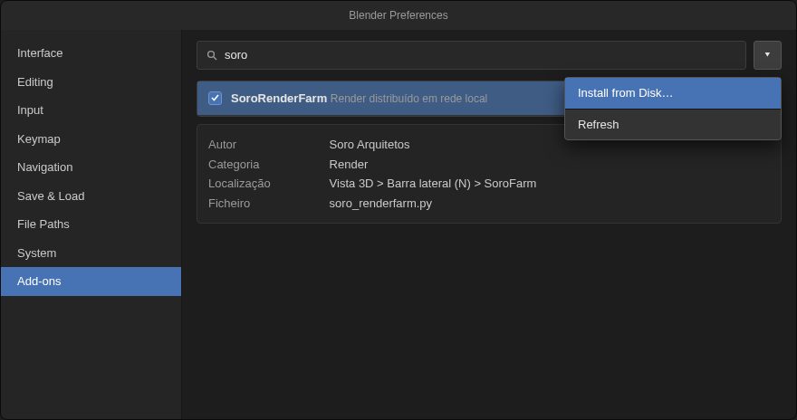
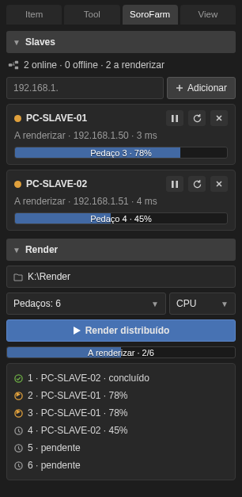

# SoroRenderFarm

Idiomas: Português · [English](README.en.md)

Render distribuído em rede local para o Blender — um único ficheiro Python. Sem Internet, sem contas, sem chaves.

O add-on divide a renderização de uma imagem em pedaços, distribui-os por vários computadores da mesma rede local e junta tudo numa imagem final, com opção de Denoise. Funciona com uma máquina principal (Master) e vários slaves.

**Versão 0.5.0** · Blender 3.6 ou mais recente · Pensado para Windows

---

## Como funciona

- **Máquina principal (Master)** — o PC onde trabalha, com o Blender e o add-on instalados. Ao iniciar o render, guarda uma cópia do ficheiro `.blend` numa pasta partilhada, divide a imagem em pedaços e envia as tarefas aos slaves.
- **Slaves** — os outros PCs. Não precisam do Blender aberto nem do add-on: corre lá o **Worker** (`python soro_renderfarm.py --worker`), um pequeno programa que recebe pedaços pela rede (porta TCP 8765) e renderiza com o Blender em modo de fundo (`blender -b`).
- Cada pedaço é guardado como **EXR 16 bits**. No fim, a máquina principal junta os EXR numa imagem final (`final.png` + `final.exr`) e mostra-a no editor de imagens do Blender.
- Se um slave desligar a meio, o pedaço é reenviado a outro. Cada pedaço tem até 3 tentativas.

## Requisitos e compatibilidade

| Requisito | Detalhes |
|---|---|
| **Mesma versão do Blender em todos os PCs** | A máquina principal guarda o `scene.blend` que os slaves abrem — use exatamente a mesma versão do Blender na principal e em cada slave |
| **Python nos slaves** | Python 3 instalado (só a biblioteca standard, nada externo). Nos slaves não precisa de instalar bibliotecas |
| **Blender nos slaves** | Instalado, nem precisa de estar aberto (o Worker encontra-o sozinho em `C:\Program Files\Blender Foundation\...`) |
| **Rede local** | Todos os PCs na mesma rede; porta TCP 8765 livre no lado dos slaves |
| **Pasta partilhada de rede** | Uma pasta acessível por todos os PCs, vista como unidade mapeada (ex.: `K:\Render`) ou caminho de rede (ex.: `\\PC\Render`) |
| **Sistema operativo** | Windows é o ambiente de referência. Em Linux/macOS o Worker também corre: defina `BLENDER_PATH` e use uma pasta com o mesmo caminho em todas as máquinas |

## Descarregar

**Ligações rápidas**

- Ficheiro do plugin: <https://github.com/ricardorocadas2026/SoroRenderFarm/raw/main/soro_renderfarm.py>
- Versões empacotadas (Releases): <https://github.com/ricardorocadas2026/SoroRenderFarm/releases>

Ou, manualmente, na página do repositório:

1. Clique no ficheiro **`soro_renderfarm.py`**.
2. Clique no botão **Raw** (ou "Download raw file") e guarde o ficheiro.

É este único ficheiro que precisa: na máquina principal para instalar o add-on, e nos slaves para o Worker.

## Instalar na máquina principal (Master)

1. Abra o Blender → **Edit > Preferences > Add-ons**.
2. Clique em **Install…** (no Blender 4.2 ou superior: menu **⌄** no canto → **Install from Disk**) e escolha o ficheiro `soro_renderfarm.py`.
3. Ative a caixa **SoroRenderFarm** na lista de add-ons.
4. Na vista 3D, prima **N** → separador **SoroFarm**.



## Preparar um Slave

1. Guarde `soro_renderfarm.py` numa pasta fixa desse PC, por exemplo `C:\SoroRenderFarm\soro_renderfarm.py`.
2. Se ainda não houver Python nesse PC, instale-o de [python.org](https://www.python.org/downloads/) e marque a opção **"Add python.exe to PATH"** na instalação.
3. Abra a linha de comandos (CMD) nessa pasta e teste:

   ```
   py soro_renderfarm.py --worker
   ```

   Deve aparecer: `SoroRenderFarm Worker 0.5.0 ativo na porta 8765 (NOME-DO-PC)` e a linha `Blender: C:\...\blender.exe`. Se aparecer "Blender não encontrado", defina `BLENDER_PATH` (ver abaixo).
4. Na primeira execução, o Windows Firewall pode perguntar se permite o acesso — clique em **Permitir** (redes privadas).

**Arranque automático com o Windows** (opcional — CMD como administrador):

```
py C:\SoroRenderFarm\soro_renderfarm.py --install-startup
```

Para remover o arranque automático: `py soro_renderfarm.py --remove-startup`

**Se o Blender não for encontrado** (instalação fora de `Program Files` ou várias versões):

```
setx BLENDER_PATH "C:\Program Files\Blender Foundation\Blender 4.2\blender.exe"
```

## Utilizar

1. Partilhe uma pasta na rede e, na máquina principal, aceda a ela por unidade mapeada (ex.: `K:\Render`) ou caminho de rede (`\\PC\Render`).
2. No Blender, painel **SoroFarm > Render**, escolha essa pasta em **"Pasta partilhada"**.
3. No painel **Slaves**, escreva o IP de um slave (ex.: `192.168.1.50`) e clique **Adicionar**. Repita para cada slave. Quando ligarem, aparece o nome do PC e o estado (Online, A renderizar, Offline…). Pode pausar, reiniciar ou remover cada slave.
4. Abra o ficheiro `.blend` do projeto, escolha o número de **Pedaços** (1–64; sugestão: nº de slaves + 1) e o dispositivo **CPU/GPU** (para Cycles).
5. Clique em **"Render distribuído"**. Acompanhe a barra geral e a lista de pedaços. Pode **Cancelar** em qualquer altura.
6. No fim aparece **"Terminado!"** — a imagem abre no editor de imagens. Os ficheiros ficam em `<pasta partilhada>\SoroFarm\<data_hora>\` (`final.png`, `final.exr`, os `tile_XXX.exr` e o `scene.blend`).
7. Opcional: botão **Denoise** para reduzir o ruído da imagem final (corre na máquina principal, demora alguns segundos).



**Comandos do Worker (nos slaves):**

```
py soro_renderfarm.py --worker            # iniciar o Worker
py soro_renderfarm.py --port 8765         # porta do Worker
py soro_renderfarm.py --install-startup   # arrancar com o Windows (como administrador)
py soro_renderfarm.py --remove-startup    # remover o arranque automático
```

**Dicas**

- Fixe o IP dos slaves ou faça uma reserva DHCP no router — a lista de slaves guarda endereços IP.
- Empacote os recursos do projeto (**File > External Data > Pack Resources**) ou garanta que as texturas estão em caminhos de rede acessíveis por todos os PCs — o `scene.blend` é partilhado, mas as texturas externas não são empacotadas automaticamente.
- Para a GPU funcionar, ative o dispositivo de computação nas preferências do Cycles em **cada slave** (Edit > Preferences > System > Cycles Render Device).

## Resolução de problemas

| Problema | Causa provável / solução |
|---|---|
| Slave não aparece "Online" | Worker não está a correr nesse PC, IP errado, ou firewall a bloquear a porta 8765. Confirme o passo 3 da preparação do slave e teste `ping` |
| "Blender não encontrado" no slave | Defina `BLENDER_PATH` com o caminho do `blender.exe` e reinicie o Worker |
| "Essa pasta é local. Use uma pasta de rede" | A pasta escolhida não é partilhada. Use uma unidade mapeada para uma partilha de rede ou um caminho `\\PC\pasta` |
| Slaves falham ao abrir o `.blend` ou faltam texturas | Versões do Blender diferentes entre PCs, ou texturas em caminhos que os slaves não alcançam. Igualar versões e empacotar recursos |
| Barra de progresso não avança / fica a 0% | O progresso por pedaço só é reportado com **Cycles**. Com Eevee o render decorre, mas sem percentagem |
| GPU ignorada nos slaves | Ative o dispositivo Cycles (GPU) nas preferências de cada slave |
| "À espera de Slaves livres…" | Todos os slaves estão ocupados, parados ou offline — verifique o painel Slaves |
| Um pedaço falha sempre | Veja o `worker.log` do slave (pasta indicada abaixo). Cada pedaço tenta 3 vezes antes de o trabalho falhar |
| Pergunta do Windows Firewall no primeiro arranque | Clique em "Permitir acesso" (redes privadas) |

## Onde ficam os ficheiros

- **Dados do programa**: `%APPDATA%\SoroRenderFarm\` no Windows (ou `~/.config/SoroRenderFarm/` em Linux/macOS):
  - `master.json` — lista de slaves guardada pela máquina principal
  - `worker.log` — registo do Worker (nos slaves)
  - `tile_render.py` — script temporário de render do pedaço
  - Pode mudar esta pasta definindo a variável de ambiente `SORO_DATA_DIR`
- **Resultados**: `<pasta partilhada>\SoroFarm\<data_hora>\` — `scene.blend`, `tile_XXX.exr`, `final.exr`, `final.png` e `final_denoise.png` (após Denoise).

## Segurança e rede local

- O Worker **aceita ligações apenas de endereços privados (rede local)** e recusa IPs públicos. Não há autenticação: qualquer computador da rede local pode enviar-lhe comandos. Use-o apenas em redes confiáveis (casa/escritório) e nunca abra a porta 8765 para a Internet.
- Não há descoberta automática de slaves — são adicionados por IP, um a um.
- Se mudar a porta de um slave (`--port`), a máquina principal não o alcançará: liga sempre à porta 8765.

## Limitações conhecidas

- Renderiza **apenas o fotograma atual** (imagem estática) — não faz animações.
- Um trabalho de cada vez na farm; cada slave renderiza um pedaço de cada vez.
- Progresso detalhado por pedaço só com Cycles.
- Pensado para **Cycles**; com Eevee o render por pedaços pode não funcionar como esperado.
- Máximo de 64 pedaços.
- Windows é o ambiente de referência (deteção do Blender, arranque automático, conversão de unidades de rede). Em Linux/macOS: defina `BLENDER_PATH` e use uma pasta com o mesmo caminho em todas as máquinas.

## Estrutura do repositório

```
soro_renderfarm.py   # tudo em um: add-on (master) + Worker (slave)
README.md
README.en.md         # documentação em inglês
LICENSE
CHANGELOG.md
docs/img/            # imagens usadas na documentação
```

## Licença e créditos

- **© Soro Arquitetos** — distribuído sob a licença **MIT** (ver ficheiro `LICENSE`).
- Versão 0.5.0 — primeira versão pública. As alterações futuras ficam registadas em `CHANGELOG.md`.
